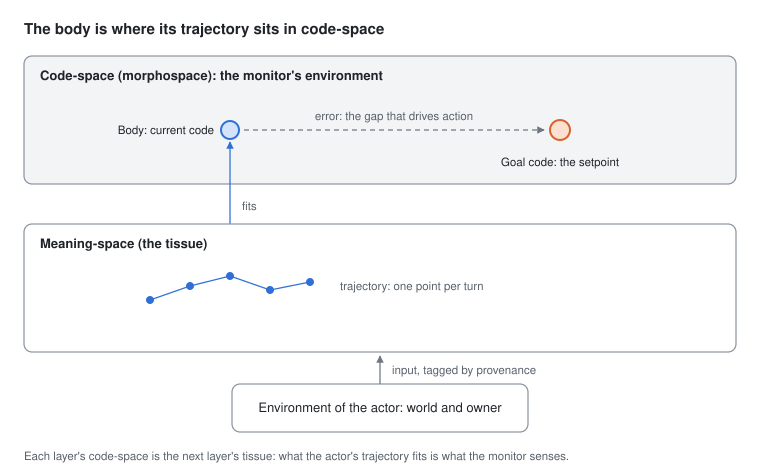

# AWARE

The goal, in the owner's words (restated 2026-11-01, DECISIONS.md): "An architecture that allows an agent to discover and
safely orient itself and the user toward a mechanistically inferred pattern in 'goal-space', a purely theoretical
higher-dimensional space where patterns over actions guide activity, using MDL, steering, and interrogation." Before
that: "The agent should function as if it is aware, even without metacognition machinery."

The entity is a trajectory through a local model's activation space (the base weights never changed;
anything learned is a removable graft), with an observer riding alongside it: a
retained low-dimensional code fit to the trajectory, and a model of the trajectory's dynamics in that code. Everything
the project does is a use of that observer. The design is the Big Picture doc
([Big Picture — v9](https://claude.ai/artifact/ByrrhB2Ue4NS8NzmyZXoCw), a Claude Doc; its Entity tab is the parent).

Since 2026-11-02 these are one project and one loop, with their measures kept apart ([PLAN.md](PLAN.md)). The two tracks
as they were built:
- **Product: drift detection, then self-correction** (`product/`). The demo: it catches the loop from the shape, not
  the words.
- **Research: reasoning over the entity's own axes** (`research/`). Relations, operations, composition and order. No
  demo yet; the reason the project exists.
- **Body** (`body/`): the body readout, a measured model of where the entity is and what moves it, for every
  capacity; spec only so far (DECISIONS.md, 2026-11-03).
- **Substrate** (`substrate/`): model access and D, the record with provenance, the geometry core, and the retained
  axes with their two admission criteria.

It runs on one machine, without cloud services: Hugging Face transformers with nnsight for activations, numpy for the
geometry.

## The picture: a creature in code-space

*Framing by the owner (2026-11-03): the agent and the owner as a creature moving through an environment; goals are
codes over actions, so goal-space is code-space; the monitor is a sense organ for goal-space. Table and the reconciling
of the two layers drafted by the model in [The Semantic Body](https://claude.ai/artifact/UfHZr9X2mDjqAkYJneUBdW),
proposed here; the owner confirms. The two layers were revised to one creature with several senses (owner,
2026-11-03).*



The creature's place is not a point in meaning-space but the code its recent moves fit, as a planarian's state is its
shape in morphospace, not a cell's spot in the tissue. **Goal is a role, not a kind of code:** every trajectory fits some
code, closures included; a code becomes a goal when a layer holds it as its target.

**One creature, several senses.** The owner and the agent are one creature in code-space (or the agent alone, or a
team). "The environment is the world and the owner" is the actor's view; "goal-space is the environment" is the
monitor's, a sense organ of the same creature, not a second agent above it. Each reflex holds a setpoint derived from
the goal the setpoint holder holds (the owner, a spec, another agent): holding the goal is a role, not a level. This is
the weak reading of Levin's multiscale competency (owner, 2026-11-03; DECISIONS.md): each level a control loop, not a mind.

| Term | For the actor | For the monitor | Biology |
|---|---|---|---|
| Environment | The world (tool results) and the owner | Code-space: the actor's codes, which it senses | An organism's surroundings |
| Tissue | Meaning-space: the fixed landscape each turn lands in | The sequence of the actor's codes | Tissue, a cell's place in it |
| Body | The trajectory and the code it currently fits | The code it fits over the actor's codes | Current shape in morphospace |
| Membrane | Provenance: partner, self, tool; read-backs count as self | What it reads from the actor and what reaches the actor | Gap junctions, coupling state |
| Goal code | Held for it by the setpoint holder | A setpoint derived from the held goal | Target anatomy |
| Error | Felt as steering: the gap the layer above measures | The gap from current code to goal code | Mismatch that drives regeneration |
| Light cone | How far in code-space, and how many turns ahead, its goal reaches | The timescale its sense covers: turn, session or project | The largest goal a system can pursue |
| Schema | — | Its compressed readout of the actor (`body/`) | Body schema, attention schema |
| Closure | Current code tightens while coupling to sources with a different signal falls | — (the creature closes, not a reflex) | A cell shrinking its self to one cell |
| Ascent | A move to a code that covers two earlier ones | — (the creature ascends, not a reflex) | A move to a new region of morphospace |

Translated findings, their tests and which elements they challenge are logged in PLAN.md, "Translations".

## Status

The framing changed on 2026-10-30 and again on 2026-10-31 (DECISIONS.md). The earlier work (freeform chat, the rung-2
memory harness, the toy world, the port of DARA's kernel) is retired at the tag `aware-rungs-final`. The product
track's toy bed has run eight rounds against pre-registered bars (PLAN.md, `product/rounds/`): v9's detectors failed
all three bars; v10's passed three of four; round 3, with sparse externals as in real sessions, failed every bar, and review traced it to a
misspecified observer (`reviews/round3/triage.md`); round 4, event-locked coupling read as news and gain, passes
five of eight, every coupling bar among them; round 5, the observer as an event record, passes eight of nine,
including a blind structure written before its code; round 6's blind structure (a partner replaying old content)
exposed that novelty is measured against recent history only; round 7a, with arrival cause and long news, passes
seven of ten, separation among them; round 7b (contingency, the reactive toy) passes seven of twelve and shows that
detecting repeated content waits on the real model's echo floor. On the owner's logged sessions, news read alone
against alone tells repeats from new content at every layer (Qwen3-0.6B, a dress rehearsal). Model access passes on real Qwen3-0.6B weights on CPU and awaits the GPU.

Since 2026-11-02 the focus is the research track and the product rests on a baseline (DECISIONS.md). The D jump on the
8B is explained and the reader now finds the attention sink by norm; Gate 1 ran, undecided. The track's question is now
causal authorship. **Where things stand and where they go next: PLAN.md, "Current state and direction".**

## Running

Python 3.11+. The geometry, axes, toy bed and Gate 1 need only numpy:

```sh
pip install -r requirements.txt
python -m pytest
python -m product.round7b                    # the toy bed, round 7b: contingency, the reactive toy
python -m product.round7a                    # round 7a: arrival cause, short and long news
python -m product.round6                     # round 6: separation narrowed, the residual descriptor
python -m product.round5                     # round 5: the event record, with a blind structure
python -m product.round4                     # round 4: event-locked coupling, news and gain
python -m product.round3                     # round 3: sparse externals, at zero, the probe
python -m product.round2                     # round 2: v10's detectors against v10's bars
python -m product.toybed                     # round 1, v9's detectors (the record)
```

Reading the model's states needs torch, transformers, nnsight and nnterp:

```sh
pip install -r requirements-model.txt
python -m substrate.measure_d --model meta-llama/Llama-3.1-8B-Instruct --run runs/d-llama   # D per layer, frozen sets
python -m pytest -m model                                                                    # Qwen3-0.6B, plumbing only
```

The echo floor (substrate), beside D. On an 8 GB card with 32 GB of RAM (an RTX 4060, say), the 8B runs in full
precision split between the GPU and RAM: slower, but exact. `--quantize 4bit` fits on the card alone, as a quick
check only, since quantisation adds noise to D.

```sh
python -m substrate.echo_floor --model meta-llama/Llama-3.1-8B-Instruct --run runs/echo-llama \
    --device auto --gpu-memory 6.5               # frozen sets; add --long for the long-session test
python -m substrate.echo_floor --model Qwen/Qwen3-8B --run runs/echo-qwen8b --device auto --gpu-memory 6.5 --long
```
